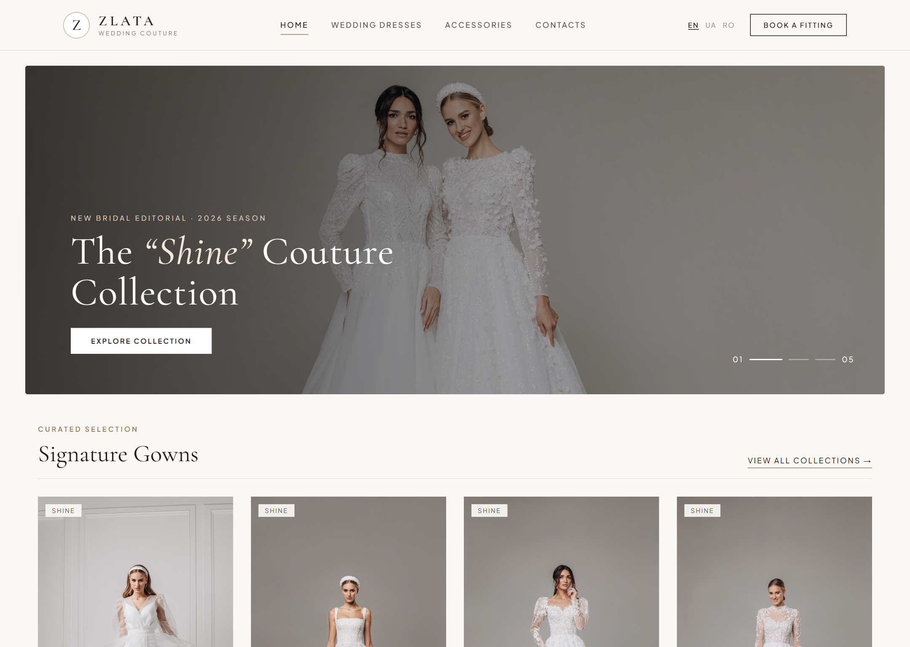
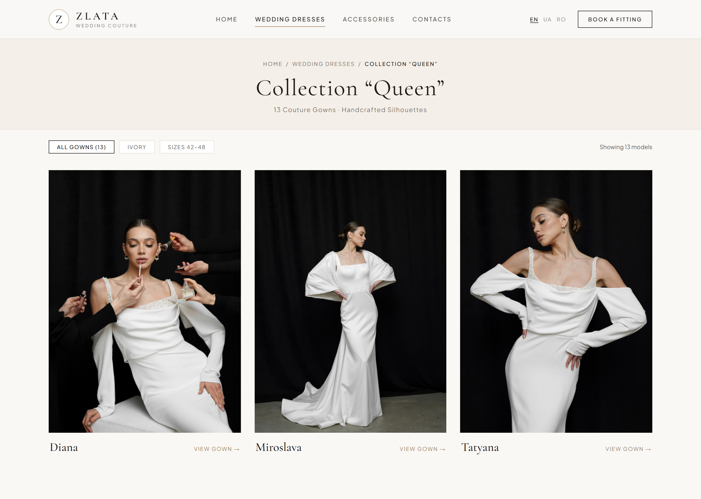
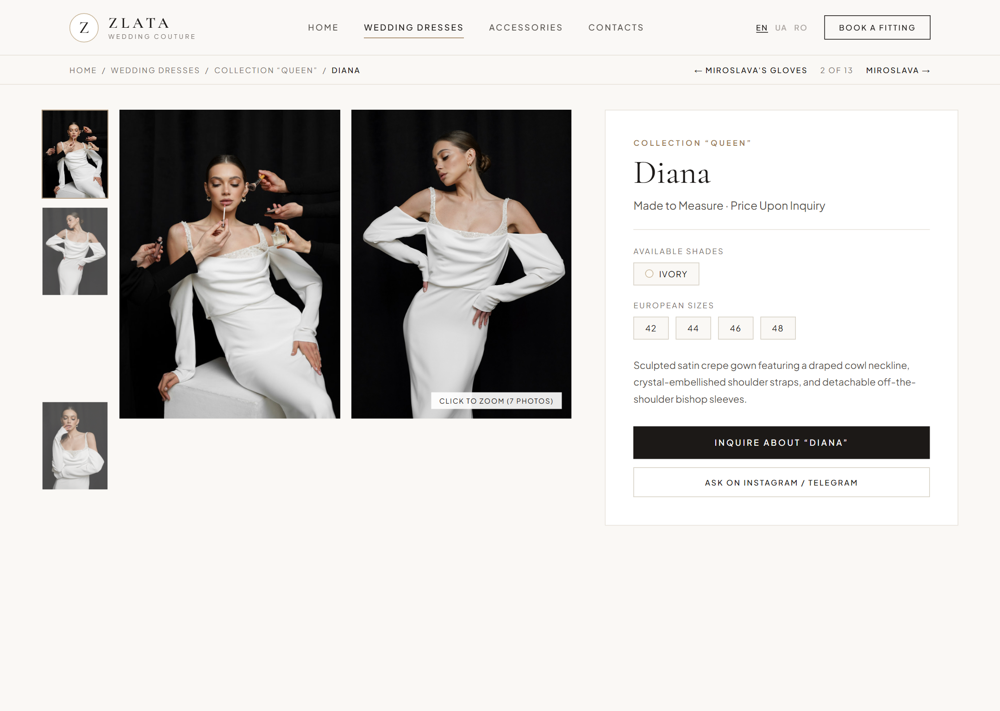
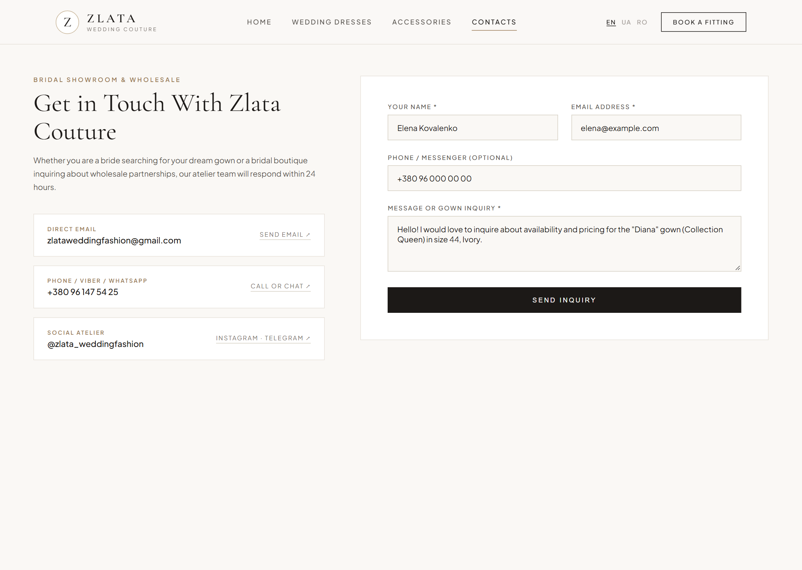

# Plan: Public Site Editorial Redesign (`client/src/app`)

## Context & Goals

The public site in `client/src/app/` is a faithful port of the original mid-2010s FreeHTML5 (`fh5co`) / Bootstrap 3 template (`site.css`, `theme.css`). While the underlying stack is modern (Rails 8.1 API + Vue 3 + TypeScript + Vite + Tailwind v4), the visual presentation, navigation, and page layouts have several UX and layout issues that hold back a luxury bridal brand:

1. **Dated Color & Typography System**: Sky-blue (`#28bbf8`) accents, neon-cyan loading ripples (`#5cffd6`), reddish-brown image drop shadows (`rgb(130 86 73)`), and forced all-caps sans-serif headings clash with bridal photography. `--font-serif` (`Crimson Text`) is loaded in `fonts.ts` and declared in `theme.css` but never applied.
2. **Header & Navigation Friction**:
   - Top-level menu links use dark `#2e2e2e` text over the transparent header while the logo is white.
   - Switching to `.fh5co-scrolled` jumps the logo position (`margin: -40px 0 0 -20px` → `top: 26px; width: 100px`).
   - Primary shopping categories (**Collections** and **Accessories**) are hidden inside a hover-only **Catalog** dropdown.
   - `useMenu.ts` checks exact path equality (`item.url === currentPath.value`), so sub-routes (`/accessories`, `/:collection`, `/:collection/:product`) lose their active navigation highlight.
   - `LanguageSelector.vue` uses `20×20px` raster country flags (`en.png` is a US flag) instead of accessible text codes (`EN`, `UA`, `RO`, `RU`).
3. **400px Fixed Blurred Inner Hero**: Every non-home page reserves a `400px` fixed blurred banner (`1-blured.jpg`), pushing actual collections, dresses, and contact forms below the fold.
4. **Hidden Lookbook Captions & Aggressive Zoom**: `ItemGrid.vue` hides dress names and prices (`opacity: 0`) on desktop until hover, covers the bottom 17% of the photo with a dark `#405d65` bar, and scales images by `1.2x` (`translateY(7.5%)`), cropping heads and hems.
5. **Product Page Gallery Overflow Bug (`ProductDetails.vue`)**: `.item-details .gallery` uses `position: absolute; top: 15px; max-width: 809px` inside `.item-details { min-height: 900px }`. Whenever a product has multiple secondary images (e.g., 1 cover + 6 thumbnails = `1815px` tall), the gallery overflows `.item-details` and overlaps the footer.
6. **Dead-End Product Page & Legacy Contact Form**:
   - Product pages have no inquiry CTA ("Inquire About This Gown") and render colors/sizes as plain comma-separated text.
   - `ContactForm.vue` hides field labels (`sr-only`), includes a legacy `Reset` button beside `Send`, and `ContactGroups.vue` renders email/phone/Viber as plain unlinked `
` text.

---

## Decisions Summary

| Area | Decision |
|---|---|
| **Scope** | Public frontend (`client/src/app/` and shared public styles/locales). Backend API contracts, URLs, SEO tags (`PageMeta`), and Admin (`client/src/admin/`) remain unchanged. |
| **Color Palette** | Warm bridal editorial palette: Alabaster (`#FAF8F5`) background, Pure White (`#FFFFFF`) surfaces, Soft Champagne (`#F4EFE8`) header bands, Deep Espresso (`#1C1917`) primary ink, Warm Stone (`#78716C`) muted ink, Warm Bronze (`#9A7B56`) accent, Hairline Sand (`#E7E2DA`) borders. |
| **Typography** | Editorial serif (`Crimson Text` / `Cormorant Garamond`) for headings, collection titles, and gown names; clean sans-serif (`Lato`) for navigation, breadcrumbs, badges, and form controls. |
| **Navigation** | Unified sticky header (`height: 80px`, `backdrop-filter: blur(12px)`). Flatten top-level menu to **Home**, **Collections** (Dresses), **Accessories**, **Contacts**, plus text language switcher (`EN · UA · RO · RU`). |
| **Inner Page Header** | Replace the `400px` fixed blurred hero (`#fh5co-hero`) with a compact champagne editorial header (`padding: 3rem 0 2.25rem`) containing breadcrumbs + serif H1. Omit the banner on Product Detail pages so the gown appears immediately above the fold. |
| **Lookbook Cards** | CSS Grid with `3:4` portrait image containers, subtle `scale(1.03)` hover, and **always-visible** serif title + price below the image. |
| **Product Page** | 2-column CSS Grid (`7fr 5fr`) in normal document flow (fixing the footer overlap bug) with a sticky details card on the right, visual chips for Colors and Sizes, and an **Inquire** CTA linking to `/contacts?product=<name>`. |
| **Contact Page** | Visible field labels, pre-filled message when `?product=` query param is present, removal of the `Reset` button, and clickable `mailto:` / `tel:` contact cards. |

---

## Visual Mockups

1. **Homepage & Editorial Hero**: [mockup-1-home.png](./site-redesign-plan/mockup-1-home.png)
   
2. **Collection Lookbook Page**: [mockup-2-collection.png](./site-redesign-plan/mockup-2-collection.png)
   
3. **Product Detail Page**: [mockup-3-product.png](./site-redesign-plan/mockup-3-product.png)
   
4. **Contacts & Gown Inquiry Page**: [mockup-4-contacts.png](./site-redesign-plan/mockup-4-contacts.png)
   

---

## Phase 1: Design System Tokens & Typography (`theme.css`, `fonts.ts`, `site.css`)

1. **Theme Tokens** (`client/src/shared/styles/theme.css`):
   - Update `@theme` variables for the editorial bridal palette while keeping semantic names intact:
     - `--color-accent: #9a7b56` (Warm Bronze, replacing `#28bbf8`)
     - `--color-accent-hover: #7d6242`
     - `--color-ink: #1c1917` (Deep Espresso)
     - `--color-ink-soft: #78716c` (Warm Stone)
     - `--color-caption: #1c1917`
     - `--color-border: #e7e2da` (Hairline Sand)
     - `--color-surface: #faf8f5` (Warm Alabaster)
     - `--color-surface-alt: #f4efe8` (Soft Champagne)
     - `--shadow-figure: 0 4px 20px -2px rgb(28 25 23 / 0.06)` (subtle neutral elevation, replacing reddish-brown shadow)
2. **Fonts** (`client/src/shared/styles/fonts.ts`):
   - Include `@fontsource/crimson-text/400-italic.css` and `600.css` (or `@fontsource/Lato/700.css`) so editorial serif headings and italic accents render crisp across platforms.
3. **Base & Frame Styles** (`client/src/app/styles/site.css`):
   - Apply `font-family: var(--font-serif)` to display headings (`h1`, `h2`, `.fh5co-heading`).
   - Modernize `.btn`, `.btn-primary`, `.btn-outline`, and `.form-control` to crisp rectangular/slightly-rounded (`2px–4px`) couture styling with uppercase letter-spaced labels (`0.16em`).
   - Replace the neon `#5cffd6` ripple loader color with `--color-accent` (`#9a7b56`).
   - Remove the empty `#fh5co-newsletter` spacer padding and the `margin-top: 400px` fixed-hero offset on `#fh5co-main`.

---

## Phase 2: Header, Navigation & Page Frame (`AppHeader.vue`, `MainMenu.vue`, `MobileMenu.vue`, `LanguageSelector.vue`, `useMenu.ts`, `PageLayout.vue`)

1. **Navigation Logic** (`client/src/app/composables/useMenu.ts`):
   - Flatten the top-level menu or support prefix/collection matching in `isActive(item)`:
     - Highlight **Collections** (`/collections`) when viewing a dress collection (`/:collection`) or dress product (`/:collection/:product` where `!collection.has_accessories`).
     - Highlight **Accessories** (`/accessories`) when viewing `/accessories` or an accessory collection/product.
2. **Desktop & Sticky Header** (`client/src/app/components/AppHeader.vue`, `MainMenu.vue`):
   - Replace the negative-margin jumping logo (`margin: -40px 0 0 -20px`) with a clean flex container (`height: 80px`, `max-width: 1320px`, `margin: 0 auto`, `padding: 0 24px`).
   - Use a sticky translucent bar (`background: rgba(250, 248, 245, 0.94); backdrop-filter: blur(12px); border-bottom: 1px solid var(--color-border)`) with consistent dark logo (`logo-black.png`) and legible `#1c1917` navigation links with an active bottom underline indicator (`#9a7b56`).
3. **Language Switcher** (`client/src/app/components/LanguageSelector.vue`):
   - Replace raster flag `` tags with clean uppercase locale labels (`UA`, `RO`, `EN`, `RU`) while keeping the existing `data-locale` attributes, `aria-label`, and `useSwitchLanguage()` behavior so unit and e2e specs continue to pass.
4. **Mobile Menu Drawer** (`client/src/app/components/MobileMenu.vue`):
   - Replace the whole-page `transform: translateX(275px)` body push with a modern slide-over drawer + semi-transparent backdrop overlay.
   - Style the mobile top bar (`height: 64px`) with a clean transparent/dark icon button instead of the solid `#28bbf8` blue square.
5. **Compact Editorial Inner Header** (`client/src/app/components/AppHeader.vue`, `PageLayout.vue`, `BreadcrumbNav.vue`):
   - Replace the `400px` fixed blurred image hero (`#fh5co-hero`) on inner pages with a compact editorial header section (`background: var(--color-surface-alt); border-bottom: 1px solid var(--color-border); padding: 44px 0 32px; text-align: center`) that integrates `BreadcrumbNav` above the serif `<h1>` page heading.
   - Allow `ProductView.vue` to pass a compact/breadcrumb-only header mode so the product gallery starts immediately below the header bar.

---

## Phase 3: Homepage & Hero Carousel (`HomeView.vue`, `SlideCarousel.vue`, `TopProducts.vue`)

1. **Hero Carousel** (`client/src/app/components/SlideCarousel.vue`):
   - Constrain slide height on desktop (`height: clamp(480px, 72vh, 760px)`) with `object-fit: cover; object-position: center 20%` so the hero fits comfortably in the viewport.
   - Add a subtle dark gradient overlay (`linear-gradient(90deg, rgba(20,17,15,0.68) 0%, rgba(20,17,15,0.25) 55%, transparent 100%)`) for reliable text contrast over white dresses, replacing the glowing grey `text-shadow`.
   - Style the slide title in large editorial serif (`clamp(32px, 4.5vw, 60px)`) and the slide link as a refined couture button.
   - Replace the round cyan Owl dots with sleek minimal progress bars (`width: 32px; height: 2px`, active `width: 52px; background: #fff`).
2. **Signature Gowns Section** (`client/src/app/components/TopProducts.vue`):
   - Add a section header with an uppercase bronze eyebrow, serif `Top Dresses` heading, and a `View All Collections →` link to `/collections`.

---

## Phase 4: Editorial Lookbook Grid (`ItemGrid.vue`, `CollectionListView.vue`, `CollectionView.vue`)

1. **Modern CSS Grid** (`client/src/app/components/ItemGrid.vue`):
   - Replace `float: left` and percentage widths with CSS Grid:
     - 1 column on mobile (`< 640px`)
     - 2 columns on tablet (`640px–1023px`)
     - 3 columns on desktop (`>= 1024px`) with `gap: 36px 28px`.
2. **Portrait Aspect Ratio & Graceful Image Loading**:
   - Wrap `` in a `3:4` aspect-ratio frame (`aspect-ratio: 3 / 4; background: #efece6; overflow: hidden`) with `object-fit: cover; object-position: top center` and `loading="lazy"`.
   - Replace the aggressive `scale(1.2) translateY(7.5%)` hover zoom with a gentle `scale(1.03)` over `500ms ease-out`.
3. **Always-Visible Editorial Captions**:
   - Render `<figcaption>` **below** the image container in normal flow (`opacity: 1` at all times on both desktop and mobile) with a serif title (`24px`, `#1c1917`) and optional formatted `.price` (`15px`, `#78716c`) underneath.

---

## Phase 5: Product Detail Page (`ProductView.vue`, `ProductDetails.vue`, `ProductGallery.vue`, `ProductNavigation.vue`, `ExtraField.vue`)

1. **Fix Gallery Overflow with 2-Column Layout** (`client/src/app/components/ProductDetails.vue`):
   - Remove `position: absolute; top: 15px; max-width: 809px` and `min-height: 900px`.
   - Use a responsive 2-column CSS Grid (`grid-template-columns: minmax(0, 7fr) minmax(340px, 5fr); gap: 48px; align-items: start; max-width: 1320px; margin: 0 auto; padding: 32px 24px 64px`).
   - On screens `< 992px`, stack into a single column (`grid-template-columns: 1fr`).
2. **Structured PhotoSwipe Gallery** (`client/src/app/components/ProductGallery.vue`):
   - Arrange product images in a clean 2-column editorial grid (with the cover image spanning full width or paired alongside the second portrait shot, and all images using `aspect-ratio: 3 / 4; object-fit: cover`) while preserving the `<a>` children and `data-pswp-width` / `data-pswp-height` attributes required by `PhotoSwipeLightbox`.
3. **Sticky Couture Info Panel** (`client/src/app/components/ProductDetails.vue`, `ExtraField.vue`, `ProductNavigation.vue`):
   - Make `.info` sticky on desktop (`position: sticky; top: 104px; background: #fff; border: 1px solid var(--color-border); padding: 36px`).
   - Style `<h1>` in `42px` serif (`#1c1917`) and `[data-testid="product-price"]` in `18px` warm stone below it.
   - Update `ExtraField.vue` to render each color and size item as a refined pill badge (`.chip`) under an uppercase section label while preserving the localized label text (`COLORS`, `SIZES`).
   - Update `ProductNavigation.vue` (`2 / 13`) to use clean typographic arrows (`←` / `→` or Lucide icons) instead of CSS border triangles.
   - Add an **"Inquire / Contacts"** CTA link (`RouterLink` to `localePath('/contacts') + '?product=' + encodeURIComponent(product.name)`) at the bottom of the info card.

---

## Phase 6: Contacts Page & Footer (`ContactsView.vue`, `ContactForm.vue`, `ContactGroups.vue`, `AppFooter.vue`)

1. **Contact Form** (`client/src/app/components/ContactForm.vue`):
   - Change `<label>` elements from `sr-only` to visible uppercase field labels (`font-size: 11px; letter-spacing: 0.14em`) while keeping `for="name"`, `for="email"`, `for="phone"`, `for="message"` and the input `placeholder` attributes intact so existing specs (`ContactForm.spec.ts`) continue to pass.
   - If `route.query.product` is present, pre-populate `form.message` with the gown name.
   - Style the primary submit button (`type="submit"`) as a full-width dark couture CTA and de-emphasize or hide the legacy reset button.
2. **Clickable Contact Channels** (`client/src/app/components/ContactGroups.vue`):
   - Style each contact group as a clean bordered card (`background: #fff; border: 1px solid var(--color-border); padding: 20px 24px`) with flexbox layout instead of `float: left/right`.
   - Automatically wrap email addresses in `<a href="mailto:...">` and phone numbers (`+380...`) in `<a href="tel:...">`.
3. **Footer** (`client/src/app/components/AppFooter.vue`, `SocialLinks.vue`):
   - Style `#fh5co-footer` with a warm champagne/alabaster background, centered brand monogram/name, social icons with subtle circular borders, and copyright line.

---

## Phase 7: Verification & Build

1. **Unit & Component Specs (`Vitest`)**:
   - Run `pnpm check` (`vue-tsc` + `eslint` + `vitest`) in `client/`.
   - Update any component tests in `client/src/app/components/*.spec.ts` or `client/src/app/views/pages.spec.ts` if they assert specific legacy DOM classes while keeping all functional assertions intact.
2. **Production Bundle & Rails Specs**:
   - Run `pnpm build` in `client/` to regenerate `public/build/` and `.vite/manifest.json`.
   - Run `docker compose run --rm -e RAILS_ENV=test web bundle exec rspec` and `docker compose run --rm web bin/ci` to verify `ViteHelper` and shell specs pass.
3. **Visual & E2E Verification**:
   - Inspect all routes (`/en`, `/en/collections`, `/en/accessories`, `/en/collection-queen`, `/en/collection-queen/diana-1`, `/en/contacts`) across desktop (`1440×900`) and mobile (`390×844`) viewports in Playwright.
   - If visual regression baselines (`client/playwright.visual.config.ts`) are used, update baselines intentionally after confirming the new design.
