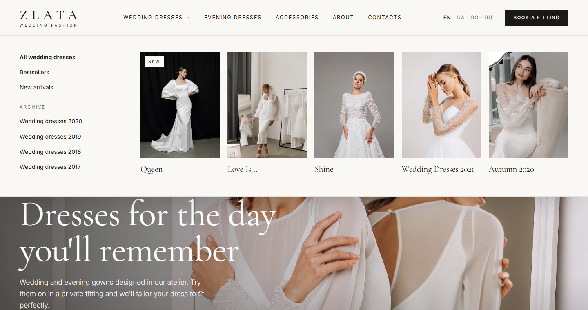
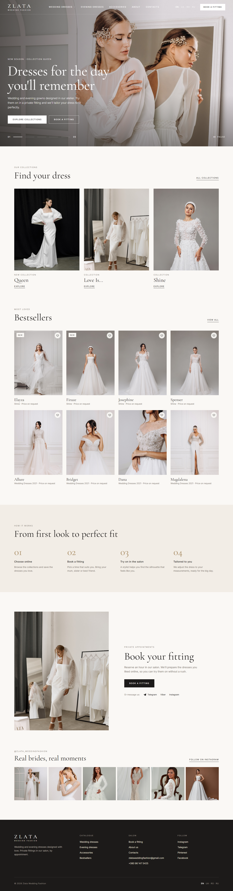
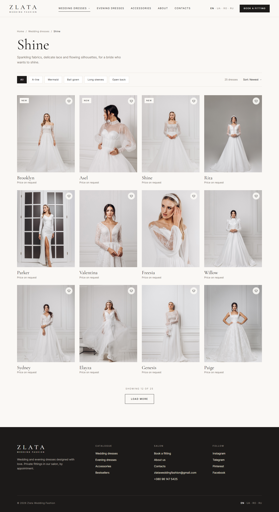
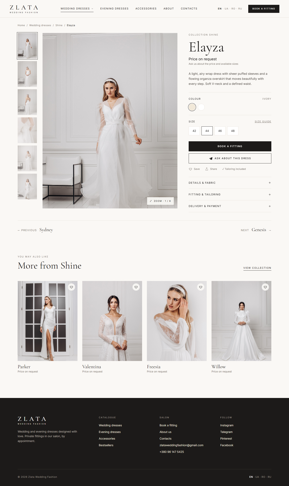
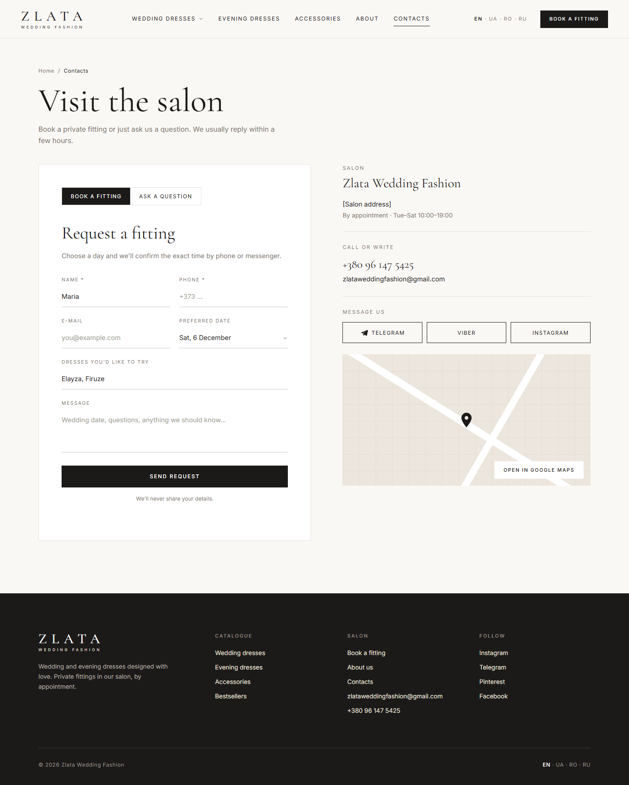
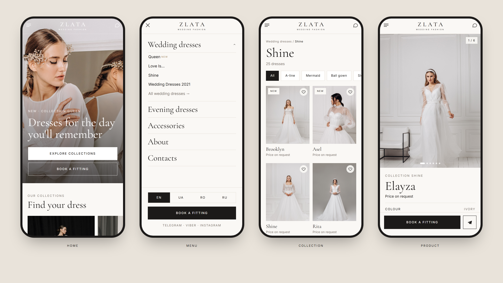

# Plan: redesign the public site

This plan comes from a review of the local site (`http://localhost:8080/en`) at desktop (1440 px) and mobile (iPhone 13) widths. It covers every public page and the whole navigation. The admin (`client/src/admin`) is out of scope.

The mockups in [site-redesign-plan/](./site-redesign-plan/) use the site's real photos and dress names from the database. Some text is placeholder; see [Placeholder content](#placeholder-content).

## Goals

- Give the site a calm, premium bridal look instead of the 2016 template style.
- Make "Book a fitting" the main action on every page. The site is a showroom, not a shop.
- Make browsing faster: smaller grids, visible names and prices, clearer navigation.
- Make the site work properly on mobile, which is where most Instagram and Telegram visitors arrive.
- Fix the accessibility, performance and SEO gaps listed below.

## 1. Current problems

### Bugs to fix whatever the redesign

| # | Where | Problem |
|---|---|---|
| 1 | Product page, desktop | The last row of gallery thumbnails overlaps the footer |
| 2 | Product page | Products with no colours or sizes still show bare "COLORS:" and "SIZES:" labels (e.g. ED-07) |
| 3 | Home, mobile | Large empty white gap between the hero and its dots |
| 4 | Accessories | The English name of the `accessoires` collection is "ACCESSOIRES". This is data, not code: rename it in the admin and check the UA/RU/RO names. The All Accessories page also shows both "ACCESSOIRES" and "ALL ACCESSORIES" cards, which is confusing |
| 5 | All Collections | Collection names only appear on hover, so desktop visitors see unlabelled photos |
| 6 | Header | No visible keyboard focus outline on nav links |
| 7 | Home hero | Each slide's button repeats the heading word for word |
| 8 | Home hero | During slide transitions the slider (`.bs-container`) can sit on top of the header and block hover and clicks |
| 9 | Home | Five `<h1>` elements, one per slide |

### Why it looks dated

- Cyan (#28bbf8) accents, pinkish `--shadow-figure` card shadows, a teal hover overlay, rounded "SEND/RESET" pill buttons, Lato for everything.
- Every inner page has the same blurred, mirrored banner about 400 px tall. On mobile it pushes the content about 40% down the screen.
- Oversized grids. Home shows 22 dresses in very large cards: about 5,900 px tall on desktop and about 12,000 px on mobile, one per row.
- The language picker is flags only, with no text.
- The Catalog dropdown has only two links (Collections, Accessories), so it adds a click without helping.
- Product pages have no description, no price on most dresses and no call to action. On mobile the details come after all the photos.
- Contacts lists Skype and has no address, map, opening hours or messenger buttons.
- Images are always about 1,800 px wide with no `srcset`, so phones download desktop-size images.

## 2. Design system

| Token | Value | Use |
|---|---|---|
| Background | `#FAF8F5` (ivory) | Page background |
| Soft background | `#F2EDE6` | Alternate sections ("How it works") |
| Ink | `#1C1A19` | Text, primary buttons, footer background |
| Muted | `#7A736C` | Secondary text, labels |
| Line | `#E7E1D9` | Borders and dividers |
| Accent | `#A88B63` (champagne) | Step numbers, "New" labels. Use sparingly |
| Heading font | Cormorant Garamond 400/500 | Page titles, product names, section headings |
| Body font | Inter 300–600 | Body text, buttons, navigation |

Rules:

- **Photos:** flat, no shadows, square or 2 px corners. Product cards are 3:4, collection cards 4:5.
- **Labels:** small uppercase with wide letter spacing ("eyebrow" style), only for labels and buttons.
- **Buttons:** solid ink (primary), outlined ink (secondary), white or outlined white over photos. 50 px tall (40 px small).
- **Spacing:** generous; sections are about 120 px apart on desktop.
- **Motion:** subtle fade or slide-in on scroll, disabled when `prefers-reduced-motion` is set.

## 3. Navigation

**Desktop header** (logo, menu, language switcher and button in one row):

- **Over the home hero:** transparent with white text, turning solid ivory with dark text once you scroll.
- **On inner pages:** solid ivory.
- **Menu:**
  - **Wedding dresses** opens a wide panel with a photo card for each current collection (the newest marked "New"), plus links to All, Bestsellers and New arrivals. Older years go under "Archive".
  - **Evening dresses** links to the collection directly.
  - **Accessories.**
  - **About.**
  - **Contacts.**
- **Right side:** a text language switcher (`EN · UA · RO · RU`) and a "Book a fitting" button.

**Mobile header:** a sticky 60 px bar with the menu icon, the logo centred and a chat icon (opens Telegram or Viber).

**Mobile menu:** a full-screen ivory panel with:

- large serif links;
- an expandable list of collections;
- a 4-way language switch;
- a full-width "Book a fitting" button;
- messenger links.

**Breadcrumbs:** small text above the page title, not a grey band.

## 4. Pages

### Home

1. **Hero:** full-screen photo with one `<h1>`, a short intro line and two buttons ("Explore collections", "Book a fitting"). If it stays a carousel: a slide counter, a pause control, slide titles in `<h2>` or `
`, and no button text that repeats the title.
2. **"Find your dress":** the three newest collections, titles always visible.
3. **"Bestsellers":** 8 top products in a 4-column grid (2 on mobile), each with its name and price line. Replaces the current 22-item list.
4. **"How it works":** 01 Choose online, 02 Book a fitting, 03 Try on in the salon, 04 Tailored to you.
5. **"Book your fitting":** a photo next to a short text, the button and messenger links.
6. **Instagram strip:** 6 square photos and a "Follow on Instagram" link.
7. **Footer:** brand blurb, catalogue links, salon contacts, social links, language switcher, ©.

### Collection and listing pages

- A short header (breadcrumbs, title, one-line description) replaces the blurred banner.
- An optional bar with filter chips, a dress count and a sort menu.
- A grid of 4 columns on desktop, 3 on tablet and 2 on mobile:
  - The name and price line ("from €150" or "Price on request") always show under each photo.
  - A "New" label on recent dresses.
  - On hover, the second photo replaces the first.
- "Load more" after 12 items, with "Showing 12 of 25" above it.
- The same pattern applies to All Collections, Evening Dresses and Accessories.

### Product page

- **Desktop:** vertical thumbnails, then the large photo (click to open the existing zoom lightbox), then an info panel that stays in view while scrolling.
- **Info panel:**
  - Collection name, product name, and the price or "Price on request".
  - Description.
  - Colour swatches and a size list. Hide a block when it has no data (bug 2).
  - Primary button "Book a fitting", which opens Contacts with the dress pre-filled.
  - Secondary button "Ask about this dress", which opens Telegram with the dress name.
  - Save and Share links.
  - Collapsible sections: Details & fabric, Fitting & tailoring, Delivery & payment.
- **Below the photos:** "← Previous / Next →" links with dress names, replacing "10 / 24", and a "More from {collection}" row of 4.

### Contacts

- **Left: a form with two tabs**, "Book a fitting" and "Ask a question".
  - Fields: name, phone, e-mail, preferred date, dresses to try (pre-filled from the product page), message.
  - One "Send request" button. Remove "Reset".
  - Inline validation and a clear success message.
- **Right: salon details.**
  - Name, address and opening hours.
  - Phone and e-mail.
  - Telegram, Viber and Instagram buttons.
  - A map with "Open in Google Maps".
  - Remove Skype.

### Mobile

- **Home:** the hero fills most of the screen, with full-width buttons; collections scroll sideways.
- **Collection:** a 2-column grid; filter chips scroll sideways.
- **Product:** a swipeable gallery with a "1 / 6" counter and dots, then the info right below it. A "Book a fitting" bar and a Telegram button stay fixed at the bottom.

### Other pages

- **404:** the short page header, a friendly message and links to Collections and Contacts.
- **About (new, optional):** the atelier story, salon photos and the fitting process. Needs content from the owner.

## 5. Accessibility, performance and SEO

- Visible focus rings on all links and buttons; text labels (or `aria-label`) on icon buttons.
- Text contrast of at least WCAG AA; no grey text on top of photos.
- One `<h1>` per page.
- Respect `prefers-reduced-motion`; stop slider autoplay on hover and focus, and add a pause button.
- **Images:**
  - Responsive `srcset`/`sizes` in AVIF or WebP.
  - `loading="lazy"` below the first screen.
  - Fixed `aspect-ratio` on image boxes so the layout doesn't jump.
  - The images are on `i.ibb.co`, which has no resizing, so this may need a resizing proxy or moving the images to storage that resizes them.
- Breadcrumb JSON-LD on inner pages. The Product JSON-LD from [product-price-plan.md](./product-price-plan.md) stays as it is.

## 6. Implementation

The admin imports `@shared/styles/theme.css` and `@shared/styles/fonts` too, so the new tokens and fonts must be scoped to the public site. Put them in `client/src/app` (for example `app/styles/site.css` or a new `app/styles/tokens.css`), or split the shared theme into a base part and per-app parts. The admin must look exactly the same after each phase.

Each phase is a separate PR. Remember: any change under `client/src` needs `pnpm build` and the regenerated `public/build/` in the **same commit**.

### Phase 0 – Bug fixes (current design)

1. Product gallery overlapping the footer: `ProductGallery.vue` / `ProductView.vue` layout.
2. Hide empty colours and sizes in `ProductDetails.vue` / `ExtraField.vue`.
3. Mobile hero gap and the slider covering the header: `HeroSlider.vue`, `SlideCarousel.vue`, `AppHeader.vue` (z-index and height).
4. Slide titles not as `<h1>`; button text not repeating the title: `HeroSlider.vue`.
5. Collection names always visible: `ItemGrid.vue`.
6. Focus styles: `MainMenu.vue`, `LanguageSelector.vue`.
7. Data fix in the admin: rename the "ACCESSOIRES" collection in all locales. Decide whether to merge it with "ALL ACCESSORIES".

### Phase 1 – Design tokens, header, footer, menus

1. **Fonts:** add `@fontsource/cormorant-garamond` and `@fontsource/inter` (or the variable versions), imported only in `app/main.ts`.
2. **Tokens:** new colours and fonts as Tailwind `@theme` values for the public site; remove `--shadow-figure` from the public site.
3. **`AppHeader.vue` + `MainMenu.vue`:**
   - The new layout, with the transparent-over-hero state.
   - The Wedding dresses panel, built from the existing `collections/dresses` API (cover images are already there).
   - The "Book a fitting" button, linking to `/:locale/contacts?type=fitting`.
4. **`LanguageSelector.vue`:** text codes instead of flags; the same locale switching logic.
5. **`MobileMenu.vue`:** the full-screen menu with an expandable collections list, the language switch and the call-to-action button.
6. **`AppFooter.vue` + `SocialLinks.vue`:** the four-column footer.
7. **`BreadcrumbNav.vue` + `PageLayout.vue`:** remove the blurred banner and add the short page header.
8. **i18n:** add the new strings ("Book a fitting", "Price on request", "How it works"…) to all four locales in `shared/i18n`.

### Phase 2 – Listings and product page

1. **`ItemGrid.vue`:**
   - 4/3/2 columns, 3:4 images.
   - Name and price line under each photo, using `usePriceLabel` and `shared/format/price.ts`.
   - Swap to the second photo on hover; a "New" label.
   - "Load more" (client-side; the API already returns all products of a collection).
2. **`CollectionView.vue` / `CollectionListView.vue`:** the new header with the description, the count and the sort menu. Filter chips only once the data exists (see Phase 4).
3. **`ProductView.vue`, `ProductGallery.vue`, `ProductDetails.vue`, `ProductNavigation.vue`:**
   - The two-column layout with the panel that stays in view.
   - Swatches and sizes.
   - The two buttons.
   - Collapsible details.
   - Previous/next links with dress names.
   - "More from {collection}".
4. **Mobile product:** a swipeable gallery and the fixed bottom bar.

### Phase 3 – Home and Contacts

1. **`HomeView.vue`:**
   - Hero: a single headline, or a carousel with the pause control.
   - "Find your dress", 8 bestsellers from `TopProducts.vue`, "How it works", the fitting section, and the Instagram strip (static images or a cached feed).
2. **`ContactsView.vue`, `ContactForm.vue`, `ContactGroups.vue`:**
   - The two tabs: Book a fitting / Ask a question.
   - The preferred date and dresses fields, pre-filled from `?dress=`.
   - Messenger buttons and the map.
   - The new fields also need changes in the `contacts#send_form` controller and the mailer.

### Phase 4 – Content and data (backend and admin)

These need decisions or content from the owner before they can be built:

- Product descriptions (the `description` field exists but is empty for most products) and fabric details.
- Prices for more dresses ([product-price-plan.md](./product-price-plan.md)).
- Filter attributes (silhouette, sleeves, neckline) as new product fields in the admin.
- Salon address, opening hours and map location.
- About page text and photos.
- Merging or renaming the two accessories collections; optionally group accessories by type.

### Testing

- Update the Vitest component specs next to each changed component.
- Update the Playwright e2e specs (`client/e2e`) for the changed selectors: header, menus, product page, contact form.
- Re-check the Rails shell and `PageMeta` specs if titles or headings change.
- Before each phase is released, check by hand at 390, 768, 1024 and 1440 px in EN and UA (the longest strings).
- The API doesn't change in phases 0–3, so `script/api_snapshot.rb` comparisons stay valid.

## Placeholder content

The mockups use real photos, dress names, collection names and contact details, but these parts are invented:

- **Text:** the hero headline and intro, the "How it works" steps, the collection description and the Elayza product description.
- **Salon details:** the address, opening hours and the map.
- **Filters:** silhouette options (A-line, Mermaid…). These product fields don't exist yet.
- **Prices:** most products show "Price on request" because the database has a price for very few dresses.
- **"New" labels:** placed by position only.
