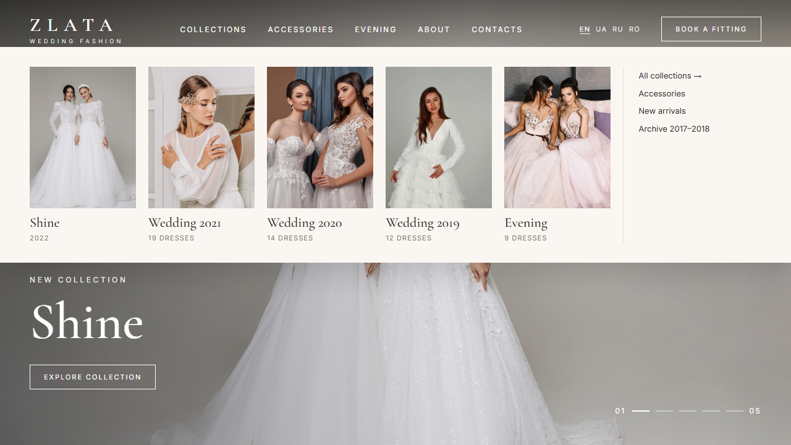
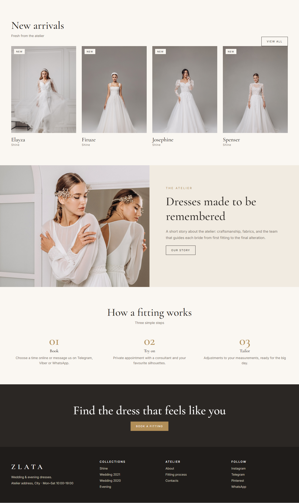
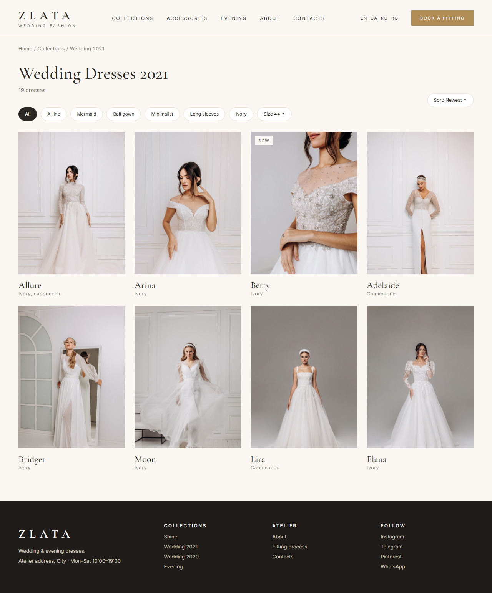
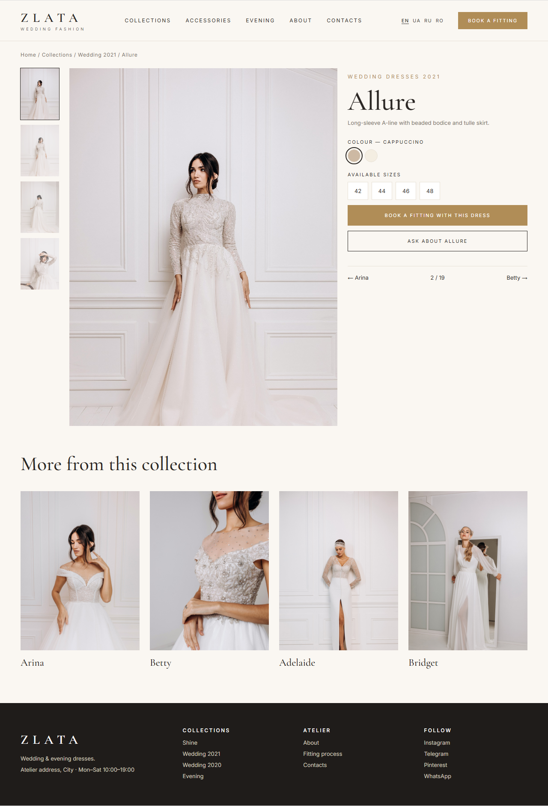
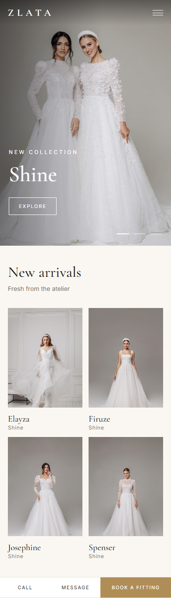
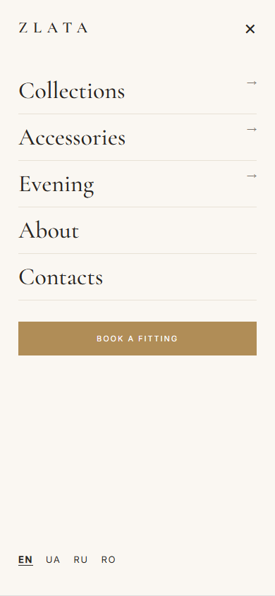
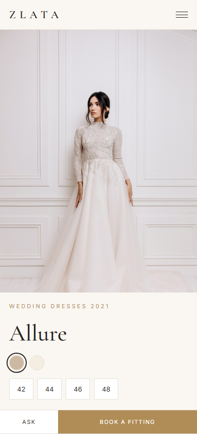

# Site redesign plan

Review of the public site (`/en`, desktop and 390 px mobile) and a proposal to make it more modern and user-friendly. The mockups in [site-redesign-plan/](./site-redesign-plan) use the existing dress photos and are illustrative only: text, counts, address and opening hours are placeholders. The HTML source of all mockups is [mockups.html](./site-redesign-plan/mockups.html); open it in a browser to tweak or re-render them (it loads the photos from ibb.co and the fonts from Google Fonts).

The backend API stays as it is. Most of the work is in `client/src/app` (Vue 3 + Tailwind).

## 1. Current state and problems

### Navigation
- The header has three items: Home, Catalog ▾ (Collections, Accessories) and Contacts, plus a flag-only language dropdown.
- The Catalog dropdown opens on hover only. It has no keyboard or touch alternative, and "Catalog" links to the same page as "Collections".
- The language options are `#` links with flag images and no text labels.
- The logo is wrapped in an `<h1>` with the alt text "logo". The home page has more `<h1>` tags: one per slide plus "Top Dresses".
- The header is transparent over the hero, so the dark nav text is hard to read on dark slides (for example Evening Dresses). After scrolling it becomes a white bar.
- On mobile the hamburger is a bright cyan square, which clashes with the brand.

### Home
- A full-screen autoplay slider with 5 slides, grey caption buttons and cyan dots below the slider instead of on it.
- "Top Dresses" is a flat list of 22 dresses from 2017 to 2021, with no season, collection label or price. On mobile it is one huge card per row.
- No brand story, "book a fitting" call to action, address or social proof.
- A 404 error appears in the browser console.

### Catalog and collection pages
- Every inner page has the same 500 px blurred hero with "ZLATA WEDDING-FASHION" above the title, which pushes the products below the fold.
- No filters, sorting or result count. Cards use pink-tinted drop shadows.
- Accessories shows two cards, "ACCESSOIRES" and "ALL ACCESSORIES", with a misspelled and confusing name.
- Inconsistent data: `COLLECTION ''SHINE''` with doubled quotes, mixed capitalisation, and two dresses called "FRANCOIZE" with different slugs (`phalla`, `francoize-1`).

### Product page
- A 4-photo mosaic with the title and a list of colours and sizes. The large title is clipped ("ALLURE").
- Images link out to external ibb.co URLs. No lightbox, description or availability.
- No enquiry call to action ("Book a fitting" / "Ask about this dress").
- Previous/next is a bare "2 / 19" counter with cyan arrows.

### Contacts
- A plain form (Name, E-mail, Phone, Message). "Send" is disabled and pale cyan, with "Reset" next to it.
- Only email, Viber and Skype are listed. Skype is outdated.
- No address, map, opening hours or tap-to-call link.

### Visual style
Elegant and light, but the cyan accents (dots, arrows, icons, buttons) clash with the brand.

## 2. Proposed redesign

### 2.1 Visual direction
Quiet editorial bridal look.
- Warm ivory background `#FAF7F2`, charcoal text `#2B2724`, one muted accent (champagne gold `#B08D57`). Remove the cyan.
- Cormorant Garamond for headings, Inter for body text. Generous whitespace, square images, no heavy shadows, subtle hover effects.
- Define these as Tailwind design tokens first so every later change reuses them.

### 2.2 Header and navigation — [mock-home.png](./site-redesign-plan/mock-home.png)
- Transparent header with a gradient scrim over the hero, turning solid on scroll, so the text stays readable on every slide.
- Items: Collections, Accessories, Evening, About, Contacts, plus a prominent **Book a fitting** button.
- Collections opens a mega-menu with thumbnails grouped by year. It must work by click, touch and keyboard (not hover only).
- Language switcher shows text (EN / UA / RU / RO) with real links.
- The logo is a link with proper alt text and is not an `<h1>`.

### 2.3 Home — [mock-home2.png](./site-redesign-plan/mock-home2.png)
- Calmer full-bleed hero with one `<h1>`, one call to action, pagination over the image, and a `prefers-reduced-motion` fallback.
- Sections: new arrivals, atelier story, 3-step fitting process, closing "Book a fitting" call to action, multi-column footer.
- Later additions: browse by style (A-line, mermaid, ball gown, minimalist), testimonials or an Instagram feed.

### 2.4 Catalog — [mock-catalog.png](./site-redesign-plan/mock-catalog.png)
- Replace the 500 px hero with a compact title, breadcrumb and result count so products show immediately.
- 2 columns on mobile, 3–4 on desktop, 3:4 images, lazy loading, optional second photo on hover.
- Filter chips (silhouette, colour, size, sleeves) and sorting.
- Merge and rename the accessories categories. Clean up duplicate and oddly named items.

### 2.5 Product page — [mock-pdp.png](./site-redesign-plan/mock-pdp.png)
- Thumbnail strip, large photo and a full-screen lightbox with zoom and swipe. Serve images from our own storage as AVIF/WebP.
- Sticky side panel: title, description, colour swatches, size chips, and two buttons: "Book a fitting with this dress" and "Ask about <dress>" (opens a message pre-filled with the dress name).
- "More from this collection", a clear back link, and previous/next links that show dress names.

### 2.6 Mobile — [mock-m1.png](./site-redesign-plan/mock-m1.png), [mock-m2.png](./site-redesign-plan/mock-m2.png), [mock-m3.png](./site-redesign-plan/mock-m3.png)
- Full-screen menu drawer with large tap targets, a "Book a fitting" button and the language switcher.
- Sticky bottom bar with Call, Message and Book a fitting.
- 2-column product grid; the product page ends in a sticky call to action.

| Home | Menu | Product |
|---|---|---|
|  |  |  |

### 2.7 Contacts (no mockup yet)
- Two columns: details and hours on one side, the form on the other.
- Address with an embedded map; tap-to-call, WhatsApp, Telegram, Viber and email links. Drop Skype.
- Inline validation, a clear success state, a spam check, "Send" enabled by default, no "Reset".

### 2.8 Footer
Multi-column footer: collections, atelier information, contacts, social links and the language switcher.

### 2.9 Accessibility and performance
- Check text contrast, add visible focus states, use landmarks and a single `<h1>` per page, and write meaningful alt text.
- Responsive `srcset` images with fixed dimensions to avoid layout shift. Fix the 404 console error.
- Keep the existing SEO strengths (canonical and hreflang tags, sitemap) and add Product and Organization JSON-LD.
- Target Lighthouse 90+ for performance, accessibility and SEO.

## 3. Implementation notes

- Work happens in `client/src/app` (shared pieces in `client/src/shared`). The admin app is not affected.
- **Frontend build output is committed.** After any change under `client/src`, run `pnpm build` and commit the regenerated `public/build/` in the same commit; never edit `public/build/` by hand.
- New product data (description, silhouette tags for filters) needs a field in the shared concern (`app/models/concerns/*_concern.rb`) and in the admin controller's strong params. Keep API responses compatible with the old app (`script/api_snapshot.rb`).
- Data clean-up (accessories names, duplicate FRANCOIZE, doubled quotes) is done through the admin UI or the data import, not in code.
- Images currently live on ibb.co. Moving them to our own storage is a separate decision.
- Validate with `pnpm check` and `pnpm test:e2e`. The visual-diff setup in `client/VISUAL_DIFF.md` will need new baselines.

## 4. Suggested phases

1. **Design tokens and header**: colours, fonts, new header, mega-menu, mobile drawer, language switcher.
2. **Catalog and product pages**: compact titles, grid, filters, gallery and lightbox, enquiry panel.
3. **Home page**: hero, new arrivals, atelier story, fitting steps, call to action.
4. **Contacts and footer**: new layout, map, messengers, form behaviour.
5. **Accessibility, SEO and performance pass**: contrast, headings, JSON-LD, image optimisation, Lighthouse check.

## 5. Open decisions

- Final palette and fonts (the mockups use ivory, charcoal, champagne gold, Cormorant Garamond, Inter).
- Whether "Book a fitting" is an online booking form or a message to a messenger.
- Real atelier address, opening hours and which messengers to show.
- Whether to add product descriptions and filter tags, and who fills them in.
